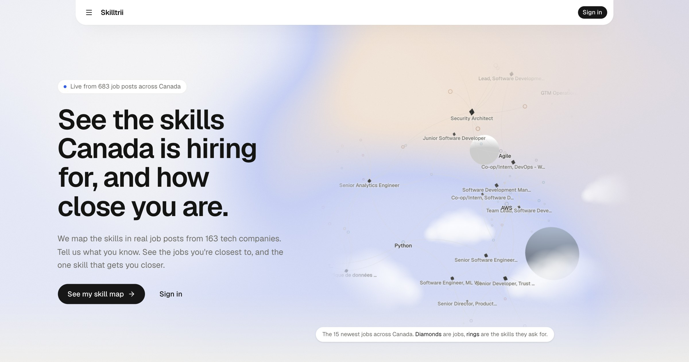
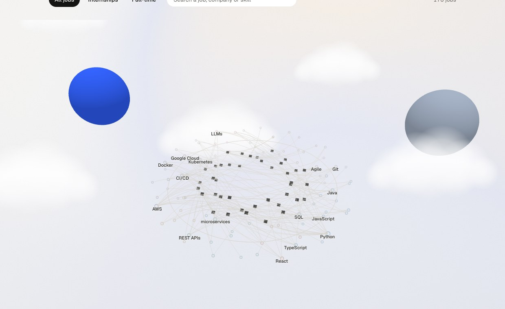
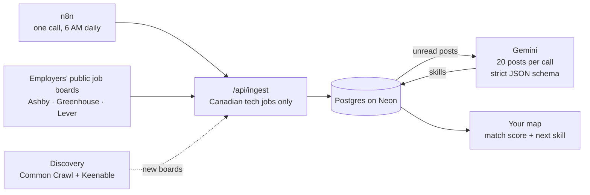

<div align="center">


# Skilltrii

**See the skills Canada is hiring for, and how close you are.**

<a href="https://www.skilltrii.work"></a>
<a href="https://hack-the-change-2026.devpost.com/"></a>


Built in 24 hours by **Team HackPack** at Hack the Change 2026.<br>
Prompt 2: in-demand skills and meaningful networks in a changing job market.

<br>



</div>

<br>

## Live, with real users

Skilltrii is a full working product, not a mockup. It's live at **[skilltrii.work](https://www.skilltrii.work)**, new jobs come in every morning, and **22 people have already signed up** and saved their skill maps.

## The problem

We're international students looking for tech work in Canada, and the market is tight.

| | |
|---|---|
| **10.4%** | unemployment for immigrants who landed in Alberta in the last five years (Oct 2026, [StatCan 14-10-0471-01](https://www150.statcan.gc.ca/t1/tbl1/en/tv.action?pid=1410047101)) |
| **2.8%** | job vacancy rate in the Calgary region, down from 4.8% in mid-2022 ([StatCan 14-10-0441-01](https://www150.statcan.gc.ca/t1/tbl1/en/tv.action?pid=1410044101)) |
| **72%** | of the tech posts we've classified want senior or lead (155 of 214). Only 14 are junior or intern. |

Every job post lists a pile of skills. Nobody tells you which ones matter right now, or what to build to prove you have them.

## What Skilltrii does

| | Step | How |
|:---:|---|---|
| **1** | **Tell us what you know** | Upload a resume. It's read in memory, matched against our skill list with no AI, and never saved. |
| **2** | **See the jobs you're closest to** | Every real job gets a match score from its must-have skills. You see what you have and what's missing. |
| **3** | **Learn the next skill** | The missing skill most of your closest jobs ask for, with weekly demand, who's hiring, free places to learn, and an Impact project built on real Canadian data. |

You see your whole map **before** you sign up. Sign in only when you want to save it.

<p align="center">
  
  <br><sub>Diamonds are real jobs. Rings are the skills they ask for.</sub>
</p>

## How it works



1. **Collect.** Every morning n8n makes one call to `/api/ingest`. The server fetches the due job boards, 20 in parallel, and keeps tech roles in Canada. A board that fails three days in a row switches itself off.
2. **Find more.** Discovery looks for new company boards in Common Crawl (monthly) and Keenable search (weekly), and checks each one before adding it.
3. **Read.** `/api/extract` sends up to 20 unread posts to Gemini in one call. It returns each post's skills, whether each one is a must-have, and the seniority. Our code keeps only answers for posts we sent, in categories we know, and turns "ReactJS" and "React.js" into one `react`.
4. **Match.** Plain SQL scores each job by the share of its must-have skills you already have. Your "next skill" is the missing must-have that shows up most in your closest jobs.
5. **Learn.** Each skill's Learning guide shows weekly demand from real posts, hand-picked free resources, and Impact projects: a real problem from Statistics Canada or UN SDG data, plus a project that practises the skill. They're generated ahead of time, so a page view never calls Gemini.

## By the numbers

<div align="center">

| 2,335 | 407 | 347 | 22 | 4,364 | 36 / 36 |
|:---:|:---:|:---:|:---:|:---:|:---:|
| Canadian tech jobs | companies hiring | skills on the map | people signed up | job boards found by discovery | unit tests passing |

<sub>Live from the database at 10 AM MT, 8 Nov 2026.</sub>

</div>

## Trust and privacy

- **Your resume is never saved.** It's parsed in memory (`unpdf`) and matched with whole-word rules. No AI reads it.
- **No account needed to see your map.** Your answers wait in an httpOnly cookie on your own browser until you choose to save.
- **We store the minimum.** Your sign-in ID, name and email, target role, city, and the skills you save. Your city guess from Vercel's IP header is never stored.
- **"Delete my data"** removes everything we hold about you, in one click.
- **Real data only.** Every job links back to the employer's own post. Every number in an Impact project is copied from the public series it cites.
- **AI is labelled** wherever it shows up in the app.

## What's next

The product works end to end. Next, we make it work for everyone:

1. **Accessibility.** A full WCAG 2.2 AA pass: keyboard and screen-reader testing on every page, a text version of the 3D map, and contrast checks on every colour.
2. **Every post read.** Gemini finishes reading the whole backlog, so every job gets a match score.
3. **Internships.** More internship and co-op sources, since so few of today's posts are junior.
4. **Career centres.** Bring Skilltrii to campus career centres and newcomer agencies.

## Tech stack

| Layer | Choice | Why |
|---|---|---|
| App | **Next.js 16** (App Router) + TypeScript | Pages and API in one codebase. Server components query the database directly. |
| UI | **shadcn/ui** (Base UI), Tailwind 4, GSAP, Lenis | Accessible parts, so our hours went into the product. |
| Map | **react-force-graph-3d** + three.js | Jobs and skills as a living graph. It sleeps when idle and respects reduced motion. |
| Data | **Neon** (Postgres) with `postgres.js` | Plain SQL, no ORM. The queries are the documentation. |
| Sign-in | **Auth0** (`@auth0/nextjs-auth0` v4) | Google or email sign-in. No passwords touch our code. |
| AI | **Gemini** (`@google/genai`) | One narrow job: post text in, skills out, as strict JSON. Falls back across three models on quota or timeouts. |
| Refresh | **n8n** | One scheduled call a day. The server decides what to fetch. |
| Public data | **StatCan WDS**, **UN SDG API**, **Keenable** | Real numbers for Impact projects, live learning links. |
| Hosting | **Vercel** | Free tier, custom domain. |

## Run it locally

```bash
npm install
cp .env.example .env.local   # fill in from the team's private chat
npm run dev                  # http://localhost:3000
```

| Command | What it does |
|---|---|
| `npm test` | unit tests (`lib/*.test.ts`) |
| `npm run lint` · `npx tsc --noEmit` | lint and type check |
| `npm run build` | production build; must pass before any PR |

Set up the database by running the files in `db/` in Neon, in the order listed in [`AGENTS.md`](AGENTS.md).

**Agents and teammates: read [`AGENTS.md`](AGENTS.md) first.** The team hub is [issue #1](https://github.com/45Clover/HackPack-/issues/1).

## AI disclosure

- **In the product:** Gemini reads job posts and lists their skills and seniority. It also writes the text of Impact projects and project ideas, ahead of time, from real public data. Both are labelled in the app.
- **Building it:** we used AI coding assistants, including Claude Code, to write and review code. Every teammate can explain the parts they own.

## Team HackPack

| | Name | Built |
|---|---|---|
|  | **Saran-Ochir Sergelen** · [@SaagiiSG](https://github.com/SaagiiSG) | UI/UX and front end: landing, onboarding, dashboard, 3D map, Learning guide, Impact projects |
|  | **Oluwatomi Alo** · [@tomi-alo](https://github.com/tomi-alo) | AI: Gemini skill extraction, prompts, skill cleanup |
|  | **Christopher Obinwa** · [@ChristopherObinwa](https://github.com/ChristopherObinwa) | Job feeds, the daily ingest, job-board discovery, the n8n workflow |
|  | **Lebohang Tangu** · [@45Clover](https://github.com/45Clover) | Job data and the n8n setup, team repo |
|  | **Favour Iheanyichukwu** · [@fabf28](https://github.com/fabf28) | Platform: database schema, Neon and Auth0 setup |

<div align="center">
<br>
<sub>Made in Calgary for <a href="https://hackthechangeyyc.ca/">Hack the Change 2026</a> by Code the Change YYC.</sub>
</div>
